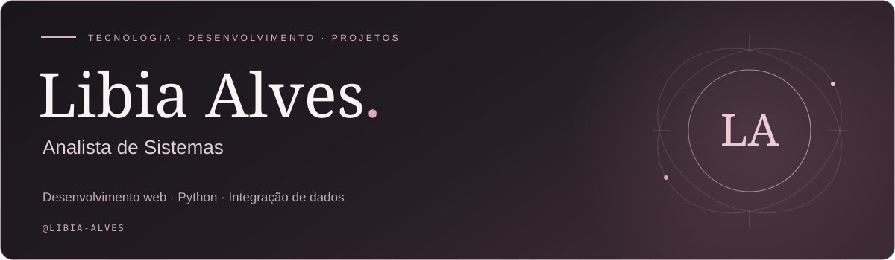
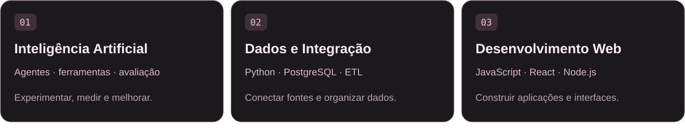
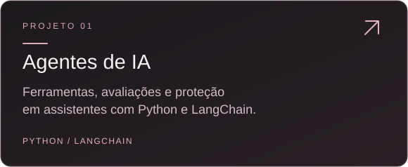
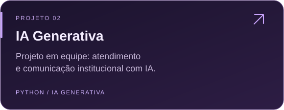
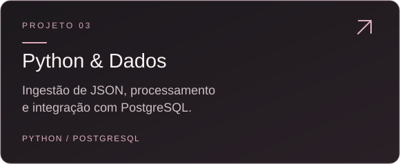
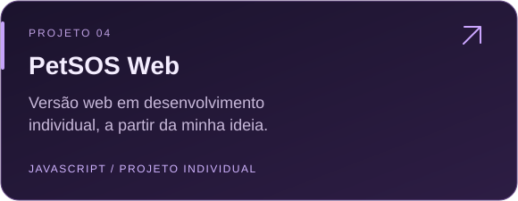
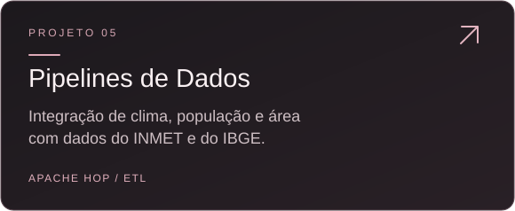
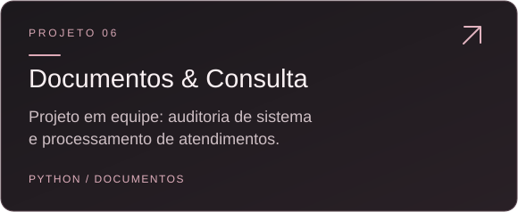
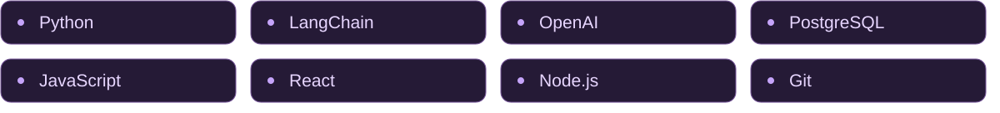
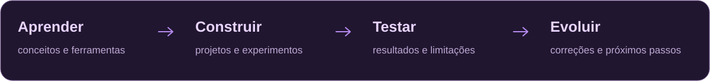

  

  <a href="#sobre-mim">Sobre mim</a> &nbsp; · &nbsp;
  <a href="#cursos-e-aprendizado">Formação</a> &nbsp; · &nbsp;
  <a href="#minhas-frentes-de-estudo">Áreas de estudo</a> &nbsp; · &nbsp;
  <a href="#projetos-em-destaque">Projetos</a> &nbsp; · &nbsp;
  <a href="#tecnologias-nos-meus-estudos">Tecnologias</a>

## Sobre mim

Olá! Eu sou a **Libia**. 💜

Já concluí um **curso profissionalizante com Node.js, React e PostgreSQL** e um **curso de Python com duração de seis meses**. Atualmente, estou cursando **Inteligência Artificial**, ampliando meu aprendizado com agentes, automação e projetos práticos.

Meu GitHub reúne essa trajetória: exercícios, experimentos e projetos desenvolvidos individualmente e em equipe.

Gosto de acompanhar o caminho completo: organizar uma fonte de dados, construir uma aplicação, integrar ferramentas e conferir se o resultado faz sentido.

- 🧠 **Foco atual:** agentes de IA, ferramentas, avaliações e automação.
- 🐍 **Na prática:** Python, integração de dados e aplicações web.
- 🔎 **Nos experimentos:** medir resultados, investigar falhas e documentar o aprendizado.
- 🤝 **Em equipe:** projetos de IA generativa, atendimento e o PetSOS.
- 💡 **Ideia própria:** o PetSOS nasceu de uma ideia minha; agora estou criando o PetSOS Web individualmente.

## Cursos e aprendizado

| Formação | Conteúdo | Situação |
| --- | --- | --- |
| **Curso profissionalizante em desenvolvimento web** | Node.js, React e PostgreSQL | Concluído |
| **Curso de Python — 6 meses** | Programação com Python | Concluído |
| **Curso de Inteligência Artificial** | Estudos e projetos de IA, incluindo o módulo de agentes | Em andamento |

Estou conectando minha base em desenvolvimento web e Python aos novos estudos de IA para construir aplicações, integrar ferramentas e avaliar seus resultados.

## Minhas frentes de estudo

  

## Projetos em destaque

  
  

  
  

  
  

<strong>Mais projetos do meu caminho de aprendizado</strong>

- [Gestão de veículos](https://github.com/libia-alves/api-gestao-veiculos-versao-2) — estudos de API com JavaScript.
- [Login com React](https://github.com/libia-alves/Sistema-de-Login-com-React-Js) — prática de desenvolvimento de interfaces.
- [Criptografia assimétrica](https://github.com/libia-alves/RSA-Cripto-Assimetrica) — estudos com Python.
- [Estudos de Node.js](https://github.com/libia-alves/estudos-nodejs) — exercícios de desenvolvimento.
- [Primeiros estudos em Python](https://github.com/libia-alves/python-1) — parte da minha trajetória com a linguagem.

## PetSOS: ideia e desenvolvimento

O **PetSOS nasceu de uma ideia minha** para contribuir com a proteção animal, e o projeto foi desenvolvido **em equipe**.

Agora estou criando **sozinha o [PetSOS Web](https://github.com/libia-alves/petsos_web)**, a versão web dessa iniciativa. É um projeto em desenvolvimento individual, no qual estou colocando em prática meus conhecimentos e ampliando a ideia original.

## Tecnologias nos meus estudos

  

| Área | O que estou explorando nos projetos |
| --- | --- |
| **IA e automação** | Modelos de linguagem, agentes, ferramentas, prompts e avaliação |
| **Dados** | JSON, SQL, PostgreSQL, integração de fontes e pipelines ETL |
| **Web** | Interfaces, aplicações com JavaScript e integração com APIs |
| **Qualidade** | Testes, registros de execução, documentação e investigação de falhas |

## O que estou construindo agora

No [módulo de Agentes de IA](https://github.com/libia-alves/agente_ia), estou aprendendo a conectar modelos a ferramentas e acompanhar as decisões que levam a uma resposta.

Meu Mini LAB utiliza contratos fictícios para estudar consultas, cálculos e proteções contra o uso de números sem origem identificada. Os experimentos comparam **acerto, tempo, passos e custo**, além de testar falhas e bloqueios indevidos.

**O aprendizado que levo desse projeto:** criar a solução é uma parte do trabalho; avaliar o que ela faz também precisa fazer parte do desenvolvimento.

## Como organizo meu aprendizado

  

Procuro registrar nos projetos:

- **O objetivo:** qual problema o exercício ou aplicação procura resolver.
- **A execução:** como instalar, configurar e experimentar o código.
- **As evidências:** testes e resultados quando fazem parte da atividade.
- **Os limites:** o que ainda precisa ser corrigido, estudado ou validado.

  <a href="https://github.com/libia-alves?tab=repositories">Explorar todos os meus repositórios ↗</a>

  

